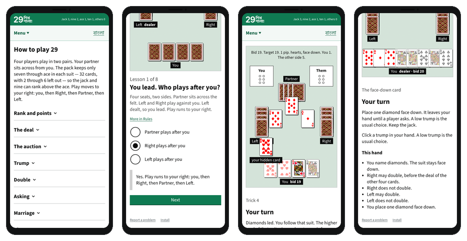

# 29 শিখ শালা

Growing up in Bangladesh, 29 was massively popular among my school friends, but I was never any good at it. It was one of those games you either knew how to play, or you didn't - no one had the patience to teach you all the tricks and tips of this [trick-taking](https://en.wikipedia.org/wiki/Trick-taking_game) card game.

Well now you can teach yourself. Play it at https://musavvirahmed.github.io/29-shikh-shala/

Contributions and issues are welcome. I especially need people to help me with the Bengali translation. You can also [report problems](https://github.com/musavvirahmed/29-shikh-shala/issues/new?template=bug.yml).
